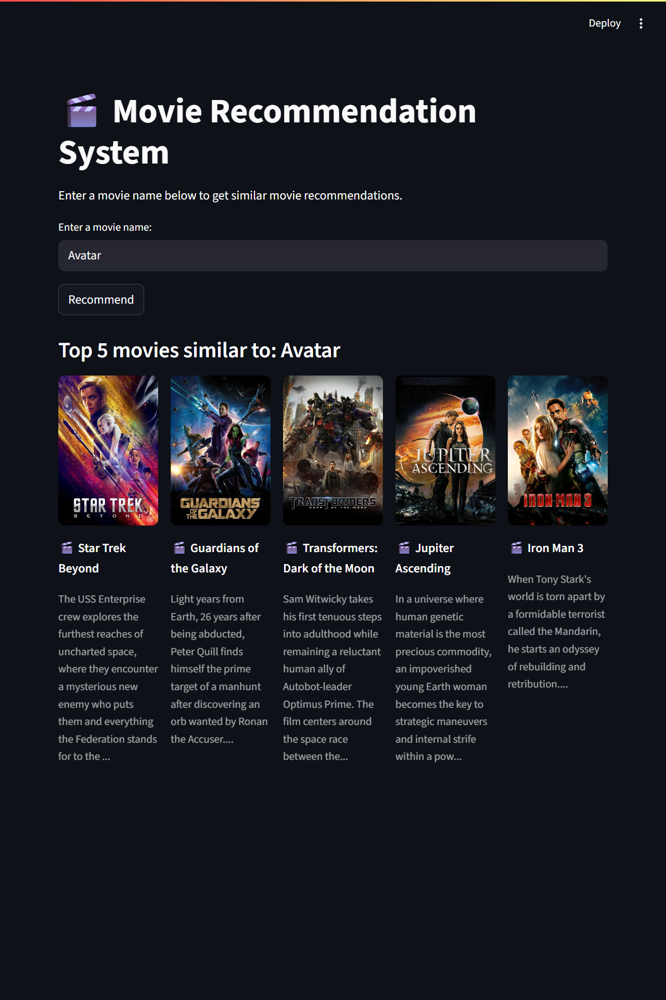
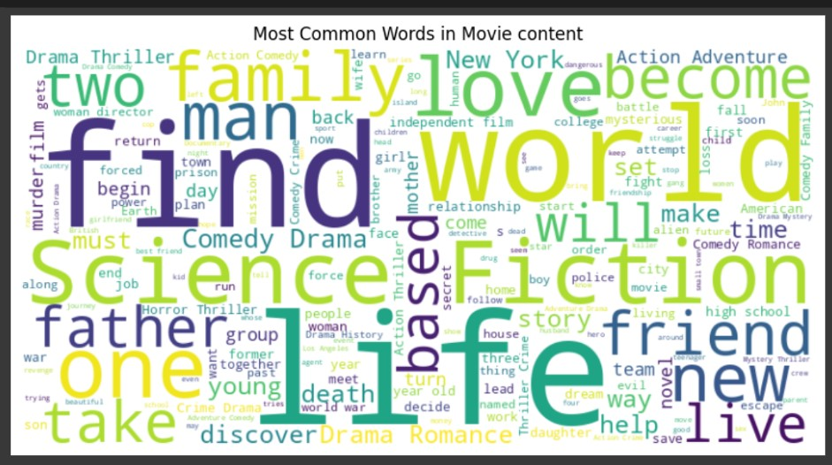

<h1 align="center">🎬 Movie Recommendation System using NLP & Streamlit</h1>

<p align="center">
A content-based movie recommender system that suggests similar movies based on genres, keywords, and descriptions. Built using Natural Language Processing (NLP), TF-IDF vectorization, and cosine similarity, and deployed with a sleek web UI via Streamlit.
</p>

<p align="center">
  
  
  
  
  
</p>

---

## 🧠 Problem Statement

Given a dataset of movies and their metadata, build a **content-based recommendation system** that suggests the most similar movies to a user-provided title using **textual similarity** techniques.

---

## 🎬 Dataset Details

* **Source:** `movies.csv` (custom-built from Kaggle TMDb dataset)
* **Columns Used:**

  * `title` – Movie title
  * `genres`, `keywords`, `overview` – Main textual features for similarity
  * `id` – TMDb ID (used to fetch posters)
* **Poster Data:** Pulled dynamically via **TMDb API**

---

## 🚀 Project Workflow

1. **Import Dependencies**
2. **Load Dataset**
3. **Data Preprocessing**

   * Combine genres, keywords, and overview into one feature
   * Clean and tokenize text
   * Remove stopwords using NLTK
4. **TF-IDF Vectorization**

   * Convert text into numerical feature vectors
5. **Similarity Computation**

   * Compute **cosine similarity** between all movie vectors
6. **Recommendation Function**

   * Return top 5 most similar movies based on similarity scores
7. **Poster Fetching**

   * Integrate with **TMDb API** to fetch movie posters via `id`
8. **WordCloud Visualization**

   * Generate a visual representation of the most frequent keywords
9. **Deploy with Streamlit**

   * Build an interactive UI for live recommendations

---

## 🌐 Web App Preview

> Type a movie title → Get top 5 similar movies + poster images + movie description

<p align="center">
  
  <br />
  <i>📸 Streamlit Web App: User enters movie name and sees recommendations with posters</i>
</p>

---

## ☁️ WordCloud Visualization

We use **WordCloud** to visualize the most frequent terms in the movie metadata (genres, keywords, overview). This helps understand what topics or themes dominate the dataset.

<p align="center">
  
  <br />
  <i>🔍 WordCloud showing dominant terms in movie descriptions</i>
</p>

---

## 📦 Installation & Setup

```bash
git clone https://github.com/Toshaksha/recommendation-system.git
cd recommendation-system
pip install -r requirements.txt
```

Set your TMDb API key in the script:

```python
TMDB_API_KEY = "your_api_key_here"
```

To launch the web app:

```bash
streamlit run app.py
```

---

## 🧪 Example Usage

```python
Input: "Avatar"
Output:
 - Star Trek Beyond
 - Jupiter Ascending
 - Guardians of the Galaxy
 - Transformers: Dark of the Moon
 - Iron Man 3 
```

Each result includes the title , the movie poster and movie description.

---

## 🗂 Project Structure

```
movie-recommendation-nlp/
│
├── app.py                              # Streamlit app
├── movie_recommendation_system.ipynb   # Development notebook/script
├── movies.csv                          # Movie metadata
├── requirements.txt                    # Python packages
├── images/
│   ├── app_screenshot.png              # Screenshot of Streamlit app
│   └── wordcloud.png                   # WordCloud image
└── README.md                           # Project documentation
```

---


## 🔧 Tools & Libraries Used

* Python 3.x
* **Pandas**, **NumPy** – Data processing
* **NLTK** – Text preprocessing
* **Scikit-learn** – TF-IDF, Cosine similarity
* **Requests** – API integration
* **Streamlit** – Web UI
* **Matplotlib**, **WordCloud** – Visualization
* **TMDb API** – Fetching movie posters

---

## 👤 Author

**Toshaksha** – [GitHub Profile](https://github.com/Toshaksha)

---

⭐ *Found this project useful? Give it a star and share with others!*

---